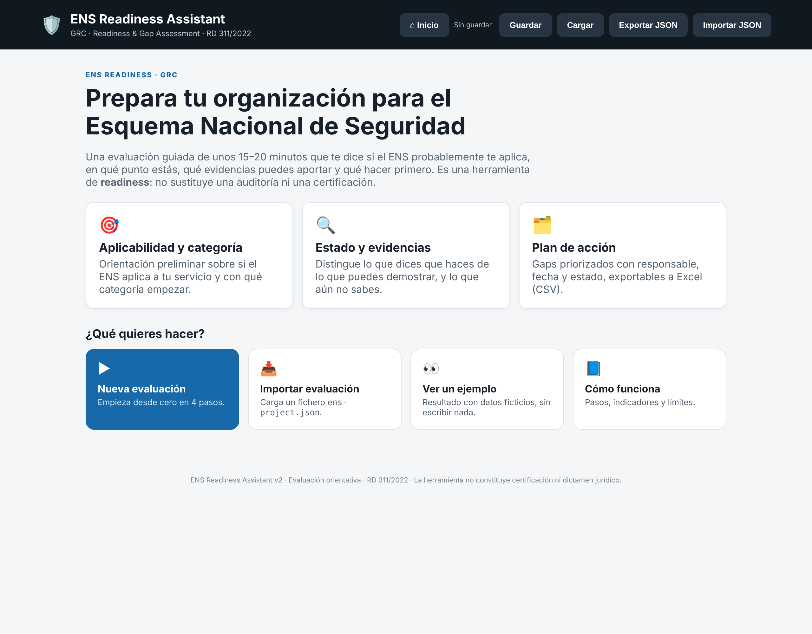
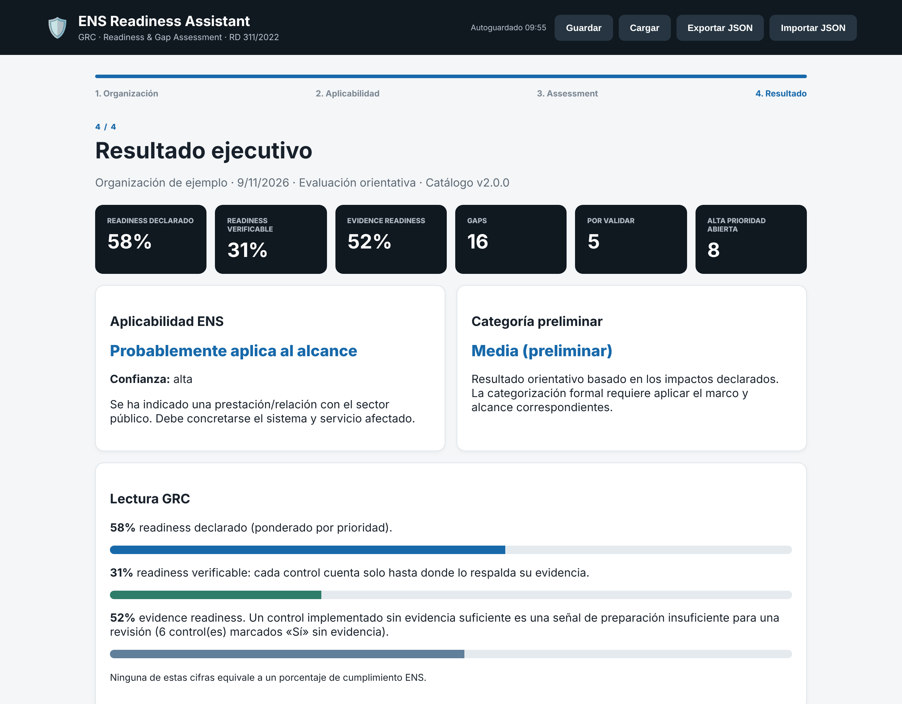

# ENS Readiness Assistant — GRC v2

Herramienta web ligera para realizar un **assessment de readiness ENS con enfoque GRC**.

## Objetivo

El proyecto no intenta sustituir una auditoría ENS ni convertirse todavía en una plataforma GRC compleja. Su función es ayudar a una organización a responder:

- ¿Cuál es nuestro contexto?
- ¿Qué aplicabilidad preliminar identificamos?
- ¿Qué controles tenemos?
- ¿Qué no sabemos?
- ¿Qué evidencias podemos aportar?
- ¿Qué gaps tenemos?
- ¿Quién debe actuar y cuándo?

## Novedades v2.1

- Corregido: evidencia, responsable, fecha y observaciones ahora se leen, guardan y exportan.
- Catálogo ampliado a 38 controles con `minCategory`; referencias ENS corregidas (aún **sin verificar**, ver `docs/ens-mapping.md`).
- Puntuación ponderada por prioridad, **readiness verificable** y separación gap / «No sé» / «sí sin evidencia».
- Desglose por área, plan ordenado, estado y esfuerzo de acciones, alertas de vencidas y sin responsable.
- Exportación del plan a CSV; importación JSON validada.
- Autoguardado con recuperación de borrador; avisos no bloqueantes; filtros y contador de progreso.
- Pantalla de inicio con introducción y menú interactivo (nueva evaluación, continuar borrador, importar, ejemplo con empresa ficticia, cómo funciona).
- Accesibilidad (foco, `aria-*`), CSP estricta sin `onclick` inline, tests (`npm test`) y CI.





## Estructura

```text
index.html
styles.css
app.js          # interfaz
logic.js        # lógica pura (puntuación, aplicabilidad, validación)
data/           # controls.js, recommendations.js, schema.js, example.js (caso ficticio)
tests/          # node --test
docs/
.github/workflows/  # CI y GitHub Pages
```

## Ejecución

No necesita backend. Abre `index.html` en el navegador o sirve el directorio con cualquier servidor estático.

## Tests

```bash
npm test   # requiere Node 20+
```

## Exportación

- `ens-project.json`: contrato de intercambio con otras herramientas GRC/ENS (incluye versión de catálogo).
- `ens-plan-de-accion.csv`: plan de acción listo para Excel.

## Metodología

El assessment separa:

```text
Estado del control
        +
Disponibilidad de evidencia
        +
Responsable
        +
Fecha objetivo
        =
Readiness GRC
```

"Sí" no significa automáticamente "cumplimiento ENS". La aplicabilidad, categorización y correspondencia normativa deben revisarse para el alcance real.

📄 Licencia

Este proyecto está publicado bajo licencia **MIT**. Puedes usarlo, modificarlo y distribuirlo libremente, citando la fuente.

Ver archivo [LICENSE](./LICENSE) para más detalles.

---

## 👤 Autor

**Himar de León González**  
Consultor GRC · Ciberseguridad · Gobernanza de IA

[](https://www.linkedin.com/in/himar-de-leon-gonzalez)


## Biblioteca, idioma y tema

La aplicación incluye una biblioteca consultable de los controles incluidos en el proyecto, selector de tema claro/oscuro persistente y un selector ES/EN para la interfaz. Las preferencias se guardan localmente en el navegador.

**Aviso normativo importante:** el catálogo heredado contiene 36 controles agrupados y sus referencias están pendientes de verificación individual. Esta versión no afirma contener las ~73 medidas/submedidas oficiales del Anexo II. Consulta `docs/normative-verification.md` antes de utilizarlo como matriz normativa. La fuente primaria es el [RD 311/2022 consolidado en el BOE](https://www.boe.es/eli/es/rd/2022/05/03/311/con).

La traducción inglesa de esta entrega cubre los elementos principales y etiquetas comunes de navegación/formulario; algunos textos de ayuda y el contenido descriptivo específico de cada control siguen en español. No se debe considerar una localización EN completa todavía.

### Idiomas

La interfaz incluye cambio de idioma español/inglés desde el botón `EN/ES`. El cambio se aplica también a los controles generados dinámicamente, filtros, biblioteca, estados, evidencias y textos del resultado.
